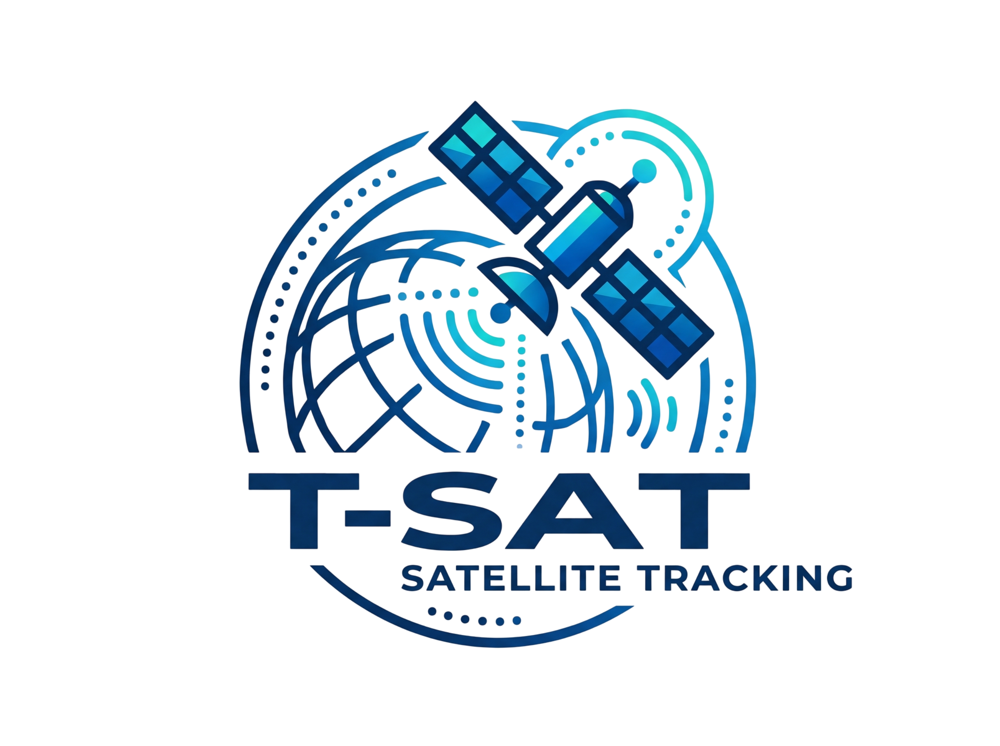
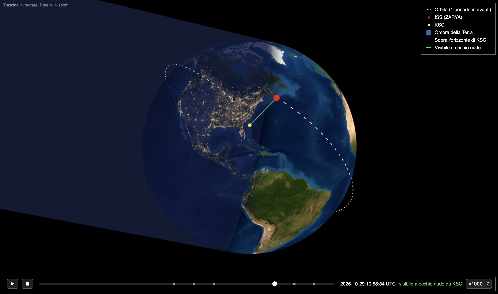

<p align="center">
  
</p>


# T-SAT

Traccia un satellite (di default la ISS, NORAD 25544) a partire dal suo TLE. Il lavoro è diviso in due parti:

- **Python (`astro.py`)**: calcola tutto e disegna i grafici 2D.
- **C++ (`render3d.cpp`)**: si occupa solo della visualizzazione 3D.

<p align="center">
  
</p>

<p align="center"><em>Il render 3D generato da <code>make run</code>: orbita della ISS (bianco), posizione attuale (rosso) e Kennedy Space Center (giallo).</em></p>

## Cosa fa

1. **Scarica il TLE** da CelesTrak. Se `tle_25544.txt` ha meno di 6 ore usa quella copia; se il download non riesce va in locale.
2. **Calcola il prossimo passaggio** sopra il Kennedy Space Center (KSC), cercando nelle 24 ore successive con un passo di 10 secondi. Stampa gli eventi AOS / MAX / LOS e lo zero Doppler ("Radial Velocity"), con azimut, elevazione, distanza e spostamento Doppler in Hz.
3. **Calcola la ground track** su un periodo orbitale (100 passi), spezzando la traccia dove attraversa l'antimeridiano.
4. **Mostra tre grafici matplotlib**:
   - la ground track sulla mappa `images/terra2.jpg`, con la posizione attuale del satellite in rosso;
   - il grafico polare del passaggio (Nord in alto, azimut in senso orario, zenit al centro);
   - la curva Doppler del passaggio sul downlink vocale ARISS a 145.800 MHz (vedi sotto).

   Controlli Doppler: il campo `f0 [MHz]` cambia la frequenza di downlink (solo ridisegno, senza ripropagare l'orbita) e il pulsante **Passaggio successivo** cerca il passaggio dopo quello mostrato e aggiorna il grafico polare e la curva Doppler.

   Passando il mouse sulla curva Doppler o sull'elevazione, un marker arancione mostra lo stesso istante sul grafico polare e sulla mappa, dove in arancione c'è anche la traccia al suolo del passaggio.
5. **Esporta una timeline di 24 ore** in `orbit3d.txt`: posizione del satellite (ITRF cartesiano, km) e direzione del Sole ogni 60 s, più gli intervalli in cui il satellite è sopra l'orizzonte di KSC o visibile a occhio nudo.
6. **C++** legge `orbit3d.txt` e genera `render3d.html`: una Terra con texture, terminatore giorno/notte, cilindro d'ombra e orbita, renderizzate in WebGL con three.js e animate lungo la timeline.

## Come funziona

```
astro.py ──► orbit3d.txt ──► render3d (C++) ──► render3d.html
   │
   └──► grafici 2D (matplotlib)
```

Python calcola, il C++ scrive l'HTML con i dati incorporati, il JavaScript della pagina interpola tra i campioni e disegna.

Formato di `orbit3d.txt` (tempi in secondi da t0, coordinate in km, tranne la direzione del Sole):

```
ISS (ZARYA)                                 nome del satellite
2026-10-28T12:00:00.000Z 60 5577.5 86400    t0 (UTC), passo, periodo orbitale, durata della timeline
x y z                                       posizione di KSC
P                                           numero di passaggi sopra l'orizzonte di KSC
inizio fine                                 un intervallo per riga (P righe)
V                                           numero di intervalli visibili a occhio nudo
inizio fine                                 un intervallo per riga (V righe)
x y z sx sy sz                              satellite e versore del Sole, un campione per riga
...
```

I campioni coprono la durata più un periodo, perché l'orbita disegnata parte dal satellite e va un periodo in avanti. Gli istanti di sorgere e tramontare sono quelli esatti di AOS e LOS; l'inizio e la fine della visibilità hanno la precisione del passo di 10 s.

Nel render 3D l'occlusione dietro la Terra è gestita dal depth buffer della GPU. Le parti nascoste dell'orbita e dei marker si vedono comunque, disegnate semitrasparenti sopra la Terra. La texture è incorporata nell'HTML in base64: aprendo il file da `file://`, il browser bloccherebbe per WebGL un'immagine caricata a parte.

### Terminatore e ombra

La direzione del Sole segue la timeline. Uno shader mescola la texture diurna e quella notturna in base al prodotto scalare tra la normale alla superficie e la direzione del Sole, con una sfumatura di circa ±6° attorno al terminatore (crepuscolo). La texture notturna va messa in `images/terra_noc.jpg`, equirettangolare e orientata come `terra2.jpg`. Se il file manca, il lato notte usa la texture diurna scurita.

L'ombra della Terra è un cilindro semitrasparente di raggio R orientato in direzione anti-Sole. Tutto è in ITRF: la Terra resta ferma e il Sole le gira attorno in un giorno, quindi terminatore e cilindro ruotano durante l'animazione (circa 23° in un periodo orbitale).

### Timeline

In basso ci sono Play/Pausa, Stop (torna all'inizio), lo slider sulle 24 ore e la velocità della simulazione (da ×60 a ×3000). Sotto lo slider i passaggi sopra l'orizzonte di KSC sono segnati in grigio, quelli visibili a occhio nudo in verde. Quando il satellite è sopra l'orizzonte compare la linea KSC → satellite, verde se è visibile a occhio nudo (satellite illuminato e Sole sotto i −6° a KSC).

Tra due campioni la posizione è interpolata linearmente e poi riportata sul raggio interpolato: la direzione segue l'arco e l'errore resta sotto il km.

## Curva Doppler

Nel frame della stazione `orb.r_dot` è la velocità radiale ṙ. Lo spostamento di frequenza è dato da:

```
Δf = −f₀ · ṙ / c
```

con `f₀ = 145.800 MHz` di default e `c` la velocità della luce. Quando il satellite si avvicina ṙ < 0 e la frequenza sale, quando si allontana scende. Lo zero cade al punto di massimo avvicinamento, a tal proposito si è usato `RadialVelocityListener`.

Per la ISS |ṙ| arriva al massimo a circa 7 km/s, cioè circa ±3.4 kHz. Nei passaggi bassi lo spostamento è minore. Per un'altra frequenza -> riga di comando in MHz:

```
python3 astro.py --freq 437.800     # oppure 437.8
```

## Requisiti

- Python 3 con `beyond`, `numpy` e `matplotlib`:
  ```
  pip install -r requirements.txt
  ```
- `clang++` con supporto C++17
- Connessione internet, per il TLE e per caricare three.js dalla CDN
- Il file `images/terra2.jpg` nella cartella del progetto

### Linux

Dopo aver installato i pacchetti di sistema:

| Distro                     | Comando                                                                             |
|----------------------------|-------------------------------------------------------------------------------------|
| Fedora                     | `sudo dnf install python3 python3-pip python3-tkinter clang make xdg-utils`         |
| Debian / Ubuntu based      | `sudo apt install python3 python3-pip python3-venv python3-tk clang make xdg-utils` |
| Arch                       | `sudo pacman -S python python-pip tk clang make xdg-utils`                          |

I pacchetti tkinter (`python3-tkinter`, `python3-tk`, `tk`) servono a matplotlib per aprire le finestre dei grafici.

`beyond` non è nei repository delle distribuzioni. Con venv:

```
python3 -m venv .venv
source .venv/bin/activate
pip install -r requirements.txt
```


## Come eseguirlo

Dalla cartella del progetto:

```
python3 astro.py
make run
```

- `python3 astro.py` stampa il passaggio, scrive `orbit3d.txt` e apre i grafici 2D (ground track, grafico polare e curva Doppler). Lo script resta in esecuzione finché non chiudi le finestre, ma `orbit3d.txt` è già stato scritto prima che si aprano.
- I calcoli sono in funzioni (`find_pass`, `ground_track`, ...) e lo script parte da `main()`: si può anche fare `import astro` da Python o Jupyter e richiamarle con altri parametri.
- `make run` compila `render3d.cpp`, genera `render3d.html` e lo apre nel browser. Se `orbit3d.txt` manca, lancia prima lo script Python.

Dopo un `git clone` il repository contiene solo i sorgenti. L'eseguibile `render3d` e i file generati (`orbit3d.txt`, `render3d.html` e la cache `tle_<NORAD_ID>.txt`) sono esclusi dal `.gitignore`. Il primo `make run` li crea tutti, quindi servono la connessione internet e le librerie Python elencate nei requisiti.

Nel render 3D: trascina per ruotare, usa la rotella per lo zoom.

Altri comandi:

| Comando        | Effetto                                                |
|----------------|--------------------------------------------------------|
| `make`         | compila soltanto l'eseguibile `render3d`               |
| `./render3d`   | rigenera `render3d.html` dall'`orbit3d.txt` attuale    |
| `make clean`   | cancella `render3d`, `render3d.html` e `orbit3d.txt`   |

`make run` non rilancia lo script Python se `orbit3d.txt` esiste già. Per far partire la timeline da adesso, rilancia `python3 astro.py` oppure fai prima `make clean`. Un `orbit3d.txt` scritto da una versione precedente non è più leggibile: `render3d` lo segnala e va rigenerato.

## Cambiare satellite o stazione

In `astro.py`:

- `NORAD_ID`: il numero di catalogo del satellite (ad esempio 20580 per Hubble);
- `KSC`: latitudine, longitudine e quota della stazione di terra;
- `F0_DEFAULT_MHZ`: la frequenza di downlink di default per la curva Doppler (`--freq` per sovrascriverla).

Se cambi satellite, il file del TLE salvato prende il nuovo nome in automatico (`tle_<NORAD_ID>.txt`). Se cambi stazione, la legenda del render 3D continua a mostrare la scritta "KSC", perché è fissa in `render3d.cpp`.

## Licenza

Distribuito con licenza MIT. Vedi il file [`LICENSE`](LICENSE).
