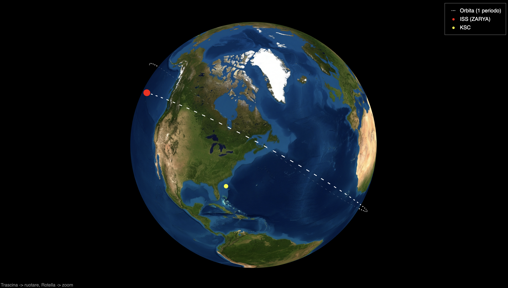

<p align="center">
  
</p>


# TSAT

Traccia un satellite (di default la ISS, NORAD 25544) a partire dal suo TLE. Il lavoro è diviso in due parti:

- **Python (`astro.py`)**: calcola tutto e disegna i grafici 2D.
- **C++ (`render3d.cpp`)**: si occupa solo della visualizzazione 3D.

<p align="center">
  
</p>

<p align="center"><em>Il render 3D generato da <code>make run</code>: orbita della ISS (bianco), posizione attuale (rosso) e Kennedy Space Center (giallo).</em></p>

## Cosa fa

1. **Scarica il TLE** da CelesTrak. Se `tle_25544.txt` ha meno di 6 ore usa quella copia; se il download non riesce va in locale.
2. **Calcola il prossimo passaggio** sopra il Kennedy Space Center (KSC), cercando nelle 24 ore successive con un passo di 10 secondi. Stampa gli eventi AOS / MAX / LOS e lo zero Doppler ("Radial Velocity"), con azimut, elevazione, distanza e spostamento Doppler in Hz.
3. **Calcola la ground track** su un periodo orbitale (100 passi), spezzando la traccia dove attraversa l'antimeridiano.
4. **Mostra tre grafici matplotlib**:
   - la ground track sulla mappa `images/terra2.jpg`, con la posizione attuale del satellite in rosso;
   - il grafico polare del passaggio (Nord in alto, azimut in senso orario, zenit al centro);
   - la curva Doppler del passaggio sul downlink vocale ARISS a 145.800 MHz (vedi sotto).
5. **Esporta l'orbita** in `orbit3d.txt`, in coordinate ITRF cartesiane espresse in km.
6. **Il programma C++** legge `orbit3d.txt` e genera `render3d.html`: una Terra con texture e l'orbita, renderizzate in WebGL con three.js.

## Come funziona

```
astro.py ──► orbit3d.txt ──► render3d (C++) ──► render3d.html
   │
   └──► grafici 2D (matplotlib)
```

Formato di `orbit3d.txt` (tutte le coordinate sono in km):

```
ISS (ZARYA)                 nome del satellite
x y z                       posizione attuale del satellite
x y z                       posizione di KSC
x y z                       punti dell'orbita, uno per riga
...
```

Nel render 3D l'occlusione dietro la Terra è gestita dal depth buffer della GPU. Le parti nascoste dell'orbita e dei marker si vedono comunque, disegnate semitrasparenti sopra la Terra. La texture è incorporata nell'HTML in base64: aprendo il file da `file://`, il browser bloccherebbe per WebGL un'immagine caricata a parte.

## Curva Doppler

Nel frame della stazione `orb.r_dot` è la velocità radiale ṙ. Lo spostamento di frequenza è dato da:

```
Δf = −f₀ · ṙ / c
```

con `f₀ = 145.800 MHz` (`F0` in `astro.py`) e `c` la velocità della luce. Quando il satellite si avvicina ṙ < 0 e la frequenza sale, quando si allontana scende. Lo zero cade al punto di massimo avvicinamento, a tal proposito si è usato `RadialVelocityListener`.

Per la ISS |ṙ| arriva al massimo a circa 7 km/s, cioè circa ±3.4 kHz, ma solo vicino all'orizzonte nei passaggi quasi sopra la testa. Nei passaggi bassi lo spostamento è minore. Per un'altra frequenza -> cambiare `F0`.

## Requisiti

- Python 3 con `beyond`, `numpy` e `matplotlib`:
  ```
  pip install -r requirements.txt
  ```
- `clang++` con supporto C++17 (su macOS: `xcode-select --install`)
- Connessione internet, per il TLE e per caricare three.js dalla CDN
- Il file `images/terra2.jpg` nella cartella del progetto

## Come eseguirlo

Dalla cartella del progetto:

```
python3 astro.py
make run
```

- `python3 astro.py` stampa il passaggio, scrive `orbit3d.txt` e apre i grafici 2D (ground track, grafico polare e curva Doppler). Lo script resta in esecuzione finché non chiudi le finestre, ma `orbit3d.txt` è già stato scritto prima che si aprano.
- `make run` compila `render3d.cpp`, genera `render3d.html` e lo apre nel browser. Se `orbit3d.txt` manca, lancia prima lo script Python.

Dopo un `git clone` il repository contiene solo i sorgenti. L'eseguibile `render3d` e i file generati (`orbit3d.txt`, `render3d.html` e la cache `tle_<NORAD_ID>.txt`) sono esclusi dal `.gitignore`. Il primo `make run` li crea tutti, quindi servono la connessione internet e le librerie Python elencate nei requisiti.

Nel render 3D: trascina per ruotare, usa la rotella per lo zoom.

Altri comandi:

| Comando        | Effetto                                                |
|----------------|--------------------------------------------------------|
| `make`         | compila soltanto l'eseguibile `render3d`               |
| `./render3d`   | rigenera `render3d.html` dall'`orbit3d.txt` attuale    |
| `make clean`   | cancella `render3d`, `render3d.html` e `orbit3d.txt`   |

`make run` non rilancia lo script Python se `orbit3d.txt` esiste già. Per aggiornare l'orbita alla posizione attuale, rilancia `python3 astro.py` oppure fai prima `make clean`.

## Cambiare satellite o stazione

In `astro.py`:

- `NORAD_ID`: il numero di catalogo del satellite (ad esempio 20580 per Hubble);
- `KSC`: latitudine, longitudine e quota della stazione di terra;
- `F0`: la frequenza di downlink usata per la curva Doppler.

Se cambi satellite, il file del TLE salvato prende il nuovo nome in automatico (`tle_<NORAD_ID>.txt`). Se cambi stazione, la legenda del render 3D continua a mostrare la scritta "KSC", perché è fissa in `render3d.cpp`.

## Licenza

Distribuito con licenza MIT. Vedi il file [`LICENSE`](LICENSE).
